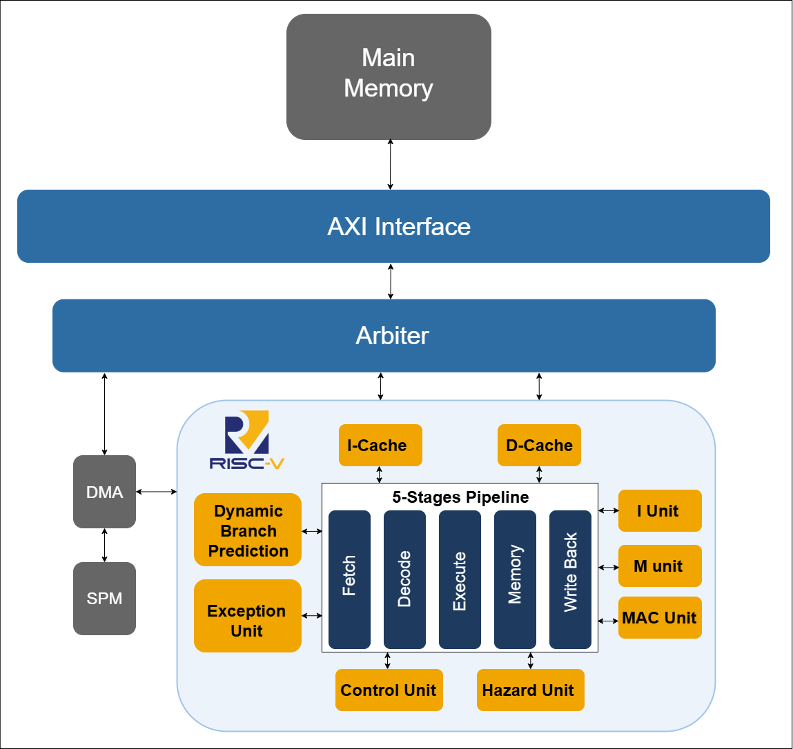

# RV64IM RISC-V Processor on FPGA

A custom 64-bit RISC-V (RV64IM) processor implemented in Verilog and deployed on FPGA.

The project started from a single-cycle processor and evolved into a 5-stage pipelined design with hazard handling, branch prediction, exception support, and the M extension. Three memory architectures (direct, cache, and hybrid cache + scratchpad) were then implemented and evaluated using a quantized MNIST inference workload running on bare-metal RISC-V.

## Features

* RV64IM ISA support
* 5-stage pipelined processor
* Hazard detection and forwarding
* Branch prediction
* Exception handling
* FPGA implementation
* Three memory architectures: direct, cache, hybrid (cache + SPM + DMA)
* Quantized MNIST inference benchmark

## Architecture

### Compact Block Diagram

### Detailed Block Diagram

## Repository Structure

`main` holds the final, polished version of the project. Each folder is described below.

| Folder | Contents |
|---|---|
| `rtl/` | Verilog source of the processor and the three memory systems (direct, cache, hybrid) |
| `benchmarks/` | Benchmark testbenches (with performance counters), benchmark programs, and results |
| `tests_asm/` | Numbered RV64I assembly tests used to verify instructions, memory access, branches and jumps |
| `mnist/` | MNIST pipeline: Python training, weight export, C inference, and the assembly inference that runs on the CPU |
| `scripts/` | Helper scripts for simulation, building, and running the benchmarks |
| `docs/` | Block diagrams and project documentation |
| `thesis/` | The full thesis report |

## Project History (Branches)

The project was built one feature at a time, each in its own branch. The branches are numbered in the order they were developed, so they work as a timeline from the first single-cycle core to the final memory-system comparison.

| # | Branch | What it added |
|---|---|---|
| 01 | `01-single-cycle-64-bit` | Single-cycle 64-bit RISC-V processor (base ISA) |
| 02 | `02-single-cycle-exception` | Exception handling added to the single-cycle design |
| 03 | `03-pipeline-branch-prediction` | 5-stage pipeline with hazard handling and branch prediction |
| 04 | `04-pipeline-exception-fpga` | Exception support in the pipeline and FPGA deployment |
| 05 | `05-pipeline-m-extension` | M extension (multiply/divide), completing RV64IM |
| 06 | `06-cache-system-icache` | Cache-based memory system, including the instruction cache |
| 07 | `07-three-memory-architectures` | The three final memory systems: direct, cache, and hybrid (cache + SPM + DMA) with MAC |
| 08 | `08-three-memory-architectures-benchmark` | Same designs with benchmark testbenches and performance counters |

<!-- verify: edit the "What it added" column if any description doesn't match what the branch really contains -->

Older branches are numbered lower. Branches 07 and 08 are the final versions.

## Memory Architectures

1. **Direct Memory System:** baseline processor with direct memory access
2. **Cache-Based System:** processor with instruction and data caches
3. **Hybrid Cache + Scratchpad Memory (SPM) System:** cache combined with scratchpad memory and DMA

## Workload

The evaluation uses a **quantized MNIST inference model** running directly on the RV64IM processor without an operating system. This provides a realistic edge-AI workload that stresses both computation and memory subsystems while remaining suitable for FPGA-based experimentation.

The full flow (training, weight export, C reference, assembly on the CPU) is in [`mnist/`](mnist/).

## Performance Metrics

The memory architectures are compared using several metrics:

* Execution latency
* Instructions per cycle (IPC)
* Stall cycles
* Cache hit/miss behavior
* Pipeline utilization
* Memory access efficiency

These measurements help quantify the trade-offs between simplicity, performance, and predictability in edge-AI systems.

## Documentation

* Thesis: see [`thesis/`](thesis/)
* Additional reports and implementation notes: [documentation folder](https://drive.google.com/drive/folders/14kQwiBb0Rn0VUSvTjwdmSYat6gmmqWsK?usp=sharing)

