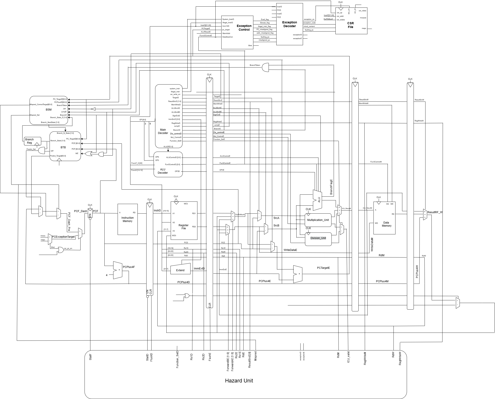

# RV64IM RISC-V Processor on FPGA

A custom 64-bit RISC-V (RV64IM) processor implemented in Verilog and deployed on FPGA.

The project started from a single-cycle processor and evolved into a 5-stage pipelined design with hazard handling, branch prediction, and exception support. Multiple memory architectures were implemented and evaluated using a quantized MNIST inference workload running on bare-metal RISC-V.

## Features

* RV64IM ISA support
* 5-stage pipelined processor
* Hazard detection and forwarding
* Branch prediction
* Exception handling
* FPGA implementation
* Quantized MNIST inference benchmark

## Memory Architectures

Three memory systems were implemented and compared:

1. **Direct Memory System**
2. **Cache-Based System**
3. **Hybrid Cache + Scratchpad Memory (SPM) System**

## Architecture

### Compact Block Diagram

### Detailed Block Diagram

## Repository Structure

### Memory System Implementations

|Branch|Description|
|---|---|
|`direct-memory-system`|Baseline processor with direct memory access|
|`cache-system`|Processor with instruction/data cache architecture|
|`hybrid-memory-system`|Processor with cache + scratchpad memory + DMA|

### Benchmarking and Evaluation

|Branch|Description|
|---|---|
|`direct-benchmark`|Benchmark environment for the direct memory architecture|
|`cache-benchmark`|Benchmark environment for the cache-based architecture|
|`hybrid-benchmark`|Benchmark environment for the hybrid architecture|

## Workload

The evaluation uses a **quantized MNIST inference model** running directly on the RV64IM processor without an operating system.
This provides a realistic edge-AI workload that stresses both computation and memory subsystems while remaining suitable for FPGA-based experimentation.

## Performance Metrics

The memory architectures are compared using several metrics:

- Execution Latency 
- Instructions Per Cycle (IPC)
- Stall Cycles   
- Cache Hit/Miss Behavior
- Pipeline Utilization  
- Memory Access Efficiency
    
These measurements help quantify the trade-offs between simplicity, performance, and predictability in edge-AI systems.

## Documentation

For detailed reports and implementation notes, see the
[documentation folder](https://drive.google.com/drive/folders/14kQwiBb0Rn0VUSvTjwdmSYat6gmmqWsK?usp=sharing).

